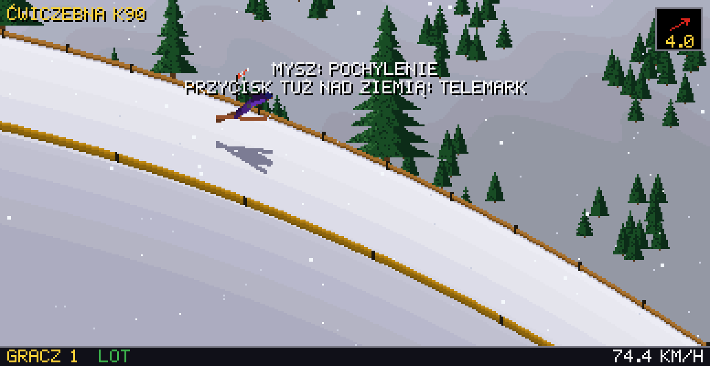

# Telemark

A ski jumping game for the browser. Its jump physics is a faithful port of Deluxe Ski Jump 2 (v2.10P, DOS, 2001),
reconstructed from an analysis of the original executable and checked against the original game frame by frame.
Graphics, interface and sound are new, made in the style of the original.



Telemark is a working title.

## Status

As of 2026-10-12: in active development.

- Playable: training mode on the built-in hill and on the 37 original hills.
- Not there yet: competitions, a replay viewer, an instructions screen.
- Not deployed anywhere; it runs locally with `pnpm dev`. No releases.

## Features

- Jump physics, wind, landing and judges' notes identical to DSJ2 v2.10P (deterministic on every device).
- One built-in hill; the 37 hills of the original become available when you load `Dsj.exe` from your own copy
  of the game. The file is read in the browser and kept only there; nothing from the original is distributed.
- Mouse, keyboard and touch controls; optional tilt steering on phones; haptics where supported.
- Pixel graphics with a responsive width, time of day (day, dusk, night) and weather (snow, fog).
- Synthesised sound (Web Audio, no recordings).
- Hill records, outfit colours and settings saved locally.

## Development

Requirements: Node 24, pnpm 12.

```sh
pnpm install
pnpm dev            # development server
pnpm typecheck
pnpm lint
pnpm format         # rewrite the sources in the project's format (oxfmt)
pnpm test
pnpm build          # production build in dist/
pnpm build:single   # the build packed into one HTML file
```

Tests that compare the port with the original game need its files and recorded traces; without them they are
skipped. See `docs/testing.md`.

## Repository layout

| Path | Contents |
|---|---|
| `src/sim` | the port of the original physics and jump logic |
| `src/original` | readers for the player's original files |
| `src/game`, `src/render`, `src/audio`, `src/ui` | game session, pixel renderer, sound, React screens |
| `src/storage` | local saves |
| `tools/re` | reverse-engineering tools (disassembler, headless DOS emulator, trace capture) |
| `tools/font` | generator of the Polish letters for the Silkscreen font |
| `scripts` | the single-file build |
| `docs` | specifications and guides, see below |

## Documentation

The notes in `docs` are mostly in Polish.

| File | Question it answers |
|---|---|
| `docs/physics-spec.md` | How does the original move the jumper on the inrun, in flight and on landing? |
| `docs/hill-format.md` | Where does the original keep its hills and how are they read? |
| `docs/jumper-figure.md` | How is the jumper drawn from a pose? |
| `docs/replay-format.md` | How are the original `.rpl` replays encoded? |
| `docs/testing.md` | Which tests exist, what do they need and how are they run? |

## Contributing

`master` changes only through pull requests merged by squash; the pull request title follows Conventional Commits
and becomes the commit. CI runs the checks above, verifies the formatting (`pnpm format:check`), tests the build
scripts (`pnpm test:scripts`), checks the build output for foreign files and bundle size (`pnpm check:dist`), and
adds a dependency audit, a secret scan, an audit of its own workflows (actionlint, zizmor) and a check for em
dashes and emoji. Security reports: see `SECURITY.md`.

## Legal

This is an independent project, not affiliated with or endorsed by the authors or publishers of Deluxe Ski Jump.
Deluxe Ski Jump is a name of its respective owner and is used here only to describe compatibility. The repository
contains no files from the original game; the game reads them from the player's own copy, locally.

The pixel font is Silkscreen with added Polish letters, under the SIL Open Font License 1.1 (`src/ui/fonts/OFL.txt`).

## License

Copyright (C) 2026 Maciej Budzyński.

This program is free software: you can redistribute it and/or modify it under the terms of the GNU General Public
License as published by the Free Software Foundation, either version 3 of the License, or (at your option) any
later version. It is distributed without any warranty. See `LICENSE` for the full text.

The license covers this project's own code and documentation. It does not cover the original game, and the font
keeps its own license (see Legal).
